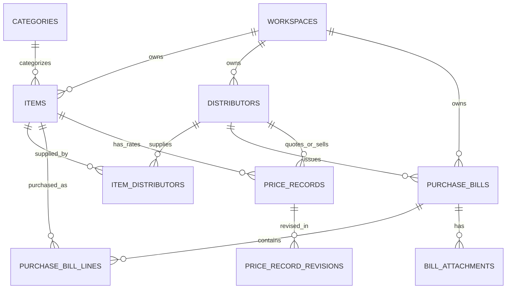
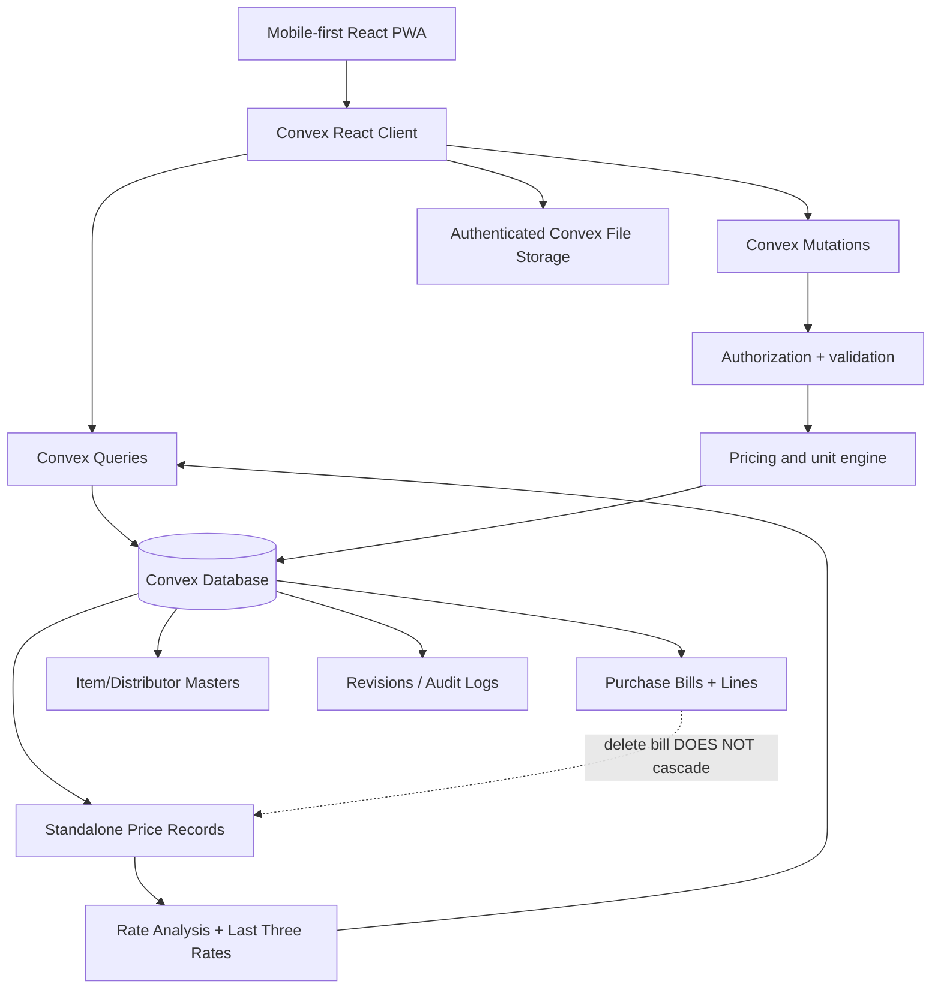

# MASTER BUILD PROMPT — MOBILE PURCHASE & RATE INTELLIGENCE APP

**Version:** 2.0 | **Date:** 2026-11-15 | **Deliverable:** Implemented, tested React PWA + Convex project and an accurate `RUN_APPLICATION.md` created **after implementation**.

> **TO THE CODING AGENT:** Execute this file as an implementation assignment, not a proposal. Read all sections and the appended product specification before making changes. You are responsible for setting up the actual dependencies and agent skills (when permitted), implementing the system, testing it, and producing final documentation based on what truly works. Do not stop after creating a mockup, PRD, empty routes, schema, or example UI. Do not claim something was tested unless the command was run successfully.

## A. Priority and source of truth

1. This **v2 master build prompt** wins on front-end framework, UI library, workflow, agent setup, and deliverables.
2. The appended **v1 complete product/business specification** wins for domain requirements, calculations, workflows, history retention, and edge cases unless this document explicitly overrides it.
3. Actual installed **UI SDK source/bundled documentation and Convex docs** win for precise supported APIs over examples in prompts.
4. Implement a cohesive application for the user, not an advanced ERP: prioritize quick mobile data entry, price comparisons, durability, and trustworthy calculations.
5. If an instruction cannot be completed because login, credentials, or deployment approval are unavailable, do all independent work, describe the blocker precisely in `RUN_APPLICATION.md`, and never invent successful verification.

## B. Required technology and architectural decisions

- React **19+**, TypeScript, Vite, client-side React Router, installable PWA.
- **PRIMARY INTERACTION COMPONENT LIBRARY: `@ui-sdk/react` + `@ui-sdk/core`** — https://ui-sdk.dev/docs/react/components. Do not substitute shadcn, Radix, MUI, Chakra, Ant Design or Vaul as the main primitives. Do not use `@ui-sdk/react` root imports. Import per-component entrypoint, e.g. `@ui-sdk/react/button`.
- Tailwind CSS v4 for styling the **unstyled** UI SDK components and application layout; semantic CSS tokens and dark-mode-ready system.
- Convex as **the only** backend, database, realtime query/mutation layer, and uploaded bill storage. No Express, Firebase, Prisma, Supabase, or PostgreSQL for this app.
- Convex authentication/authorization using a supported current integration; do not add unauthenticated write or file endpoints. Select an appropriate current authentication approach after checking official docs and implementing access controls. Personal/small-business workspace supports owner/admin and staff appropriately.
- React Hook Form + Zod for client forms; Convex argument validators and server-side business validations; React Router for navigation; Lucide React for icons; Recharts for relevant price trends; date-fns for date utilities; safe integer-based money/quantity calculations (or a vetted decimal strategy) rather than floating-point money accumulation; Playwright/Vitest for tests.
- Mobile UX first: high-quality PWA on Android Chrome and iOS Safari; responsive desktop pages; light theme primary, dark mode optional. No React Native in v1.
- Use SDK primitives **before** inventing controls. For absent components (e.g. complex bill-line editor) compose UI SDK primitives and documented `@ui-sdk/core` behaviors, not a second UI component framework.
- Treat UI SDK as **beta**: lock resolved version in lockfile, verify each API against installed docs and record version in final doc.

## C. SDK documentation protocol — mandatory

Before coding components:

1. Read https://ui-sdk.dev/docs/react , https://ui-sdk.dev/docs/react/installation , https://ui-sdk.dev/docs/react/components , https://ui-sdk.dev/docs/react/styling-and-animation .
2. Install `@ui-sdk/react @ui-sdk/core`. React must be 19+; check `@types/react` compatibility (UI SDK documentation specifies >=19.2.10).
3. Read `node_modules/@ui-sdk/react/docs/llms.txt` before creating UI SDK components. To implement custom primitives, search `node_modules/@ui-sdk/react/docs/core.md` by relevant heading and read `rendering.md` alongside it. See installed skill `node_modules/@ui-sdk/core/skills/ui-sdk/SKILL.md` if required.
4. Add to root `AGENTS.md`: **'Before using ui-sdk, use ui-sdk skill if installed, read node_modules/@ui-sdk/react/docs/llms.txt; for custom behaviors inspect core.md and rendering.md; check component docs for exact part names and event signatures.'**
5. In global CSS declare `@layer ui-sdk;` BEFORE `@import "tailwindcss";` and use state/data attributes documented by UI SDK. Never assume SDK components are pre-styled or styled with shadcn tokens by default.
6. Validate actual part composition, controlled state, popup portal behavior, mobile keyboard and focus, error states, and accessibility. Use documented imports only.

### C.1 Required UI SDK mapping

| Use case | UI SDK primitives / composition | Required behavior |
|---|---|---|
| Search item/distributor | Combobox, Autocomplete, Listbox, Field | Search by name, aliases; select existing or intentional create-new flow; preserve context |
| Bill/enquiry price and quantity | Number Input, Field, Input, Select | Numeric mobile keyboard; validate; preserve decimal precision; show derived cost |
| Price history | Accordion, Collapsible, Timeline, Tabs | Last 3 **purchase** and last 3 **enquiry** separately; full dated timeline |
| Mobile filters | Drawer, Checkbox, Select, Date Picker, Segmented Control | Apply/reset independent filters; range-only results work |
| Bill upload | File Input, Progress, Alert Dialog | Camera/file chooser, format/size validation, upload progress, clear errors |
| Delete/archive | Alert Dialog, Button, Toast | Explicit confirmation; bill deletion must not remove immutable history |
| Item master and bill edit | Dialog, Field, Tabs, Combobox, Number Input | Correct focus, validation, keyboard handling and screen reader names |
| Price enquiry logging | Drawer/Dialog, Date Picker, Combobox | Directly launch from any item/distributor and prefill context |
| Rate analysis | Date Picker, Combobox, Tabs, Segmented Control | Date-only, item-only, distributor-only, combined filters |
| Navigation | Accessible custom bottom nav with native links + SDK where relevant | 5 destinations, 44px touch sizes, safe-area support |
| Notifications | Toast | Success, error, retry, never falsely claim saved |

**Never** implement a visually attractive but disconnected UI. Every supported create/edit/save/delete/filter interaction must have a functional handler, server validation and appropriate state updates.

## D. First-time project and dependency install

Prefer **npm** for consistent cross-platform Windows PowerShell/macOS/Linux commands. If starting in an empty directory:

```bash
npm create vite@latest purchase-rate-app -- --template react-ts
cd purchase-rate-app
npm install
```

If code already exists, adapt, do not overwrite. Install runtime dependencies (versions selected for compatibility and locked by `package-lock.json`):

```bash
npm install react@^19 react-dom@^19 @ui-sdk/react @ui-sdk/core convex react-router lucide-react react-hook-form zod @hookform/resolvers recharts date-fns clsx tailwind-merge
npm install -D typescript @types/react@^19.2.10 @types/react-dom@^19 vite @vitejs/plugin-react tailwindcss @tailwindcss/vite vite-plugin-pwa vitest @testing-library/react @testing-library/user-event @testing-library/jest-dom jsdom @playwright/test eslint typescript-eslint
```

If library compatibility fails, use latest mutually supported stable versions; document deviations. Do not blindly install extra packages: UI SDK already offers Drawer, Date Picker, File Input, Toast, etc. Avoid unnecessary `vaul`, `react-day-picker`, `sonner`, shadcn CLI components, and duplicate component systems. `react-router` contains routing; test version compatibility before implementation.

### D.1 Required coding agent skills (install at project root)

Use official Skills CLI. If interactive, choose appropriate compatible coding-agent destination and project scope. **Run commands in the user's working repository, not on an unrelated machine or only in instructions.**

```bash
npx skills add vercel-labs/ui --skill ui-sdk
npx skills add convex/agent-skills --all
npx skills add anthropics/skills --skill frontend-design
npx skills add vercel-labs/agent-skills --skill vercel-react-best-practices
npx skills add vercel-labs/agent-skills --skill web-design-guidelines
npx skills add vercel-labs/agent-skills --skill vercel-composition-patterns
npx skills add anthropics/skills --skill webapp-testing
```

**Notes:** UI SDK skill is from `vercel-labs/ui`, not `shadcn/ui`. Convex officially supports `npx skills add convex/agent-skills --all` and provides skills for quickstart, schema, auth, functions, testing, production and migration. More skills is not intrinsically better: activate relevant skills per step rather than injecting every skill into every prompt. Verify each command/skill is available when run; if a named skill changes or fails, discover the maintained counterpart and record the result. **Do not require shadcn skill or install shadcn component library**, since this project explicitly uses UI SDK. Optional additional skill installation requires concrete benefit and a provenance/security review.

### D.2 Convex initial setup

```bash
npx convex dev
```

Follow CLI prompts to log in/create or select a project, link deployment, generate `convex/_generated`, and populate `.env.local` with the required Vite Convex URL (`VITE_CONVEX_URL`). Validate using the current official Convex React quickstart: https://docs.convex.dev/quickstart/react and skills https://docs.convex.dev/ai/agent-skills .

Provide a **real** runnable app. If credentials are needed but not available to agent, generate all code and `.env.example` and provide honest setup steps; don't invent a deployment ID or URL. Never commit secrets or `.env.local`.

### D.3 Package scripts (implement/verify actual names)

- `npm run dev` — Vite app dev server
- `npm run build` — strict TypeScript checking + Vite production build
- `npm run lint` — lint source
- `npm run test` — Vitest unit/component tests
- `npm run test:e2e` — Playwright smoke/E2E suite
- `npm run preview` — serve production build
- Optional `npm run typecheck` — TS noEmit; `npm run check` aggregating tests/lint/build

Include scripts and test configuration; verify commands. Agents must **not** write untested commands into final `RUN_APPLICATION.md` as though verified.

## E. Experience direction / actual design brief

Create an unusually clear, trustworthy **mobile purchasing companion** for a grocery/supermarket operator — not a generic SaaS marketing dashboard. Use compact density with plenty of breathing room for touch, legible numbers and transparent price math. Design direction:

- Product personality: confident, useful, calm and fast. High hierarchy for item, latest rate, quantity, distributor, date, and difference from last price.
- Color direction (starting suggestion, refine with frontend-design skill): ink `#142D38`, deep teal `#116D68`, soft mist `#F5F8F8`, warm amber `#C77E1E` for quotation comparison, error `#B42318`, and white `#FFFFFF`. Semantic text/status tokens; never rely on red/green alone. Avoid meaningless gradients.
- Typography: highly readable system sans or locally available sans, tabular numeric glyphs for INR, strong contrast. No remote proprietary fonts needed.
- Spacing: 4px scale; 44x44px minimum touch targets; bottom safe-area inset; scroll only where intentional; sticky total/save on long bill forms; keyboard never obscures active field.
- Responsive: 320, 360, 390, 430, 768, 1024px, no horizontal overflow. On wide screens use useful two-column editor/summary, not a stretched mobile form.
- Bottom nav: Home / Bills / Items / Rates / More. Distributors and Enquiries reachable in More and contextual shortcuts, with direct routes.
- Lightweight confirmations and empty states. Use proper localized ₹ `en-IN`, user timezone `Asia/Kolkata`, human-readable day/month/year; store unambiguous timestamps and day keys.
- Offline: PWA installability and shell caching, **not** false promise of offline writes. If offline edits are unsupported, clearly show no connection and prevent silent lost submissions.
- Include semantic accessibility: visible focus, high contrast, keyboard traversal, dialog/drawer focus management, reduced-motion respect, assistive labels and validation summaries.

### E.1 Concrete mobile layouts

**Dashboard**: purchase value + number of bills (correct period), large 'New bill' and 'Log enquiry' actions, recent activity, quick shortcuts to items/distributors/rate analysis. Every metric must come from actual Convex queries, never static fake totals in production.

**Bills list**: date range chips, distributor selector, search by bill number/item, bill rows/cards (date, supplier, bill number, amount, number items); grouping by date; tap detail, edit, delete via confirmation, and upload entry action. Paginate, don't load entire history at once.

**New / edit bill** (most important): supplier combobox and quick-create; bill date/number; optional bill photo/PDF; multiple compact line editors with item combobox, package unit, packs, content per pack, basis and input price; always-visible normalized unit price plus total; sticky summary/save; price history collapsed by default directly adjacent to editable price; duplicate detection; empty-input guard; predictable focus and back behavior.

**Price history widget**: two folded headings: `Purchases (3)` and `Enquiries (3)`, show date + supplier + quantity/pack + normalized ₹/unit, and compare current typed rate to latest comparable rate with absolute and percentage difference; expandable full history route. Enquiry quote never presented as an actual purchase.

**Item master/details**: editable category, name/aliases, base UOM, packaging defaults (e.g., bag with 50 kg, box with 15 pieces), preferred distributor, recent purchases/enquiries, open enquiry action, cross-supplier rate comparisons. No false 'stock available' indicator unless real inventory quantities are tracked.

**Distributor master/details**: editable supplier data, mapped items, default/preferred supplier selection per item, quote logging prefilled with distributor, full historical interaction, current/comparable rates; easy add multiple item prices in one session.

**Enquiry**: enter one or multiple item rates for a selected distributor; preserve quote date, unit, validity/note, normalized rate, no bill needed. Reopen/edit with audit and history semantics.

**Rate analysis**: date-only usable by itself; optional item, distributor, category, price type, UOM and comparisons; filter bottom sheet; both chart and chronological results; group by item/distributor/date; show absolute unit rates and percentage changes only for comparable bases; empty-result clear filter action; performant indexed pagination.

### E.2 Critical pricing math and validation

- Base quantity = number of packages × content per package; `4 bags × 50 kg = 200 kg`.
- If rate is **₹1,000 per bag**: total = 4 × 1,000 = ₹4,000; normalized = ₹1,000 / 50 = ₹20/kg.
- If rate is **₹1,000 for the entire line**: total = ₹1,000; normalized = ₹1,000 / 200 = ₹5/kg. Explicit input basis selector prevents ambiguity.
- If **₹20/kg**, total = 200 × ₹20 = ₹4,000. Show basis and conversion openly.
- Never compare kg and pieces as if interchangeable; unit conversion must be explicit, compatible and reproducible. Keep snapshots of package size and unit in transaction and history to preserve old price interpretation after item defaults change.
- Avoid float drift; use integer paise / sensible decimal scaling for relevant business quantities and test rounding explicitly. Never quietly round away quantity precision.
- Every edit or delete operation must preserve a traceable immutable actual price record per the appended v1 specification; distinguish **recorded original price**, **corrected price**, and current value to avoid misleading price trend data.
- Keep current query results and history event semantics consistent after edits; transactionally write related records via Convex mutations. Never recalculate historic normalized prices with current item pack defaults.

## F. Convex data modeling, security, and reliability

Implement production-grade schema with indexes and typed validators for:

- Workspace / tenant and membership, user roles, auth identity mapping.
- Item categories, items, unit/package defaults, active/archive state, item aliases.
- Distributors, item-distributor associations / preferred distributor mapping.
- Bills, bill line snapshots, file metadata and Convex file IDs.
- Price enquiry batch/header (if applicable), enquiry lines / quote records.
- Append-only price observations / changes with type `purchase` or `enquiry`, origin references, timestamp, date, entered unit/rate, normalized rate, package snapshot, supplier/item IDs, audit metadata, correction/superseded state, **retained on bill deletion**.
- Audit log for meaningful mutations and deletion; use workspace-scoped, permission-checked reads/writes; don't expose cross-tenant documents/files.
- Optional idempotency key for form double-submission and bill imports; transaction-level duplicate checks.

All Convex handlers must validate identity and role on server, not rely on client authorization. Use efficient Convex indexes/pagination/search and handle large lists. File storage must use proper authorized upload flow and access checks; sanitize/validate file types (images/PDF), size limit and errors; manage orphan storage references safely without deleting retained historical price data. Keep provenance of deleted bills via price-history snapshots, not a dangling entity that causes crashes. Avoid destructive cascade deletes.

Authentication must be real before deployment. If the developer cannot complete auth provisioning without account access, record blocking setup steps explicitly; never expose a publicly writable database as a workaround.

## G. Project structure target (adapt only where justified)

```text
purchase-rate-app/
  AGENTS.md
  README.md
  RUN_APPLICATION.md            # Mandatory FINAL output, generated from reality
  .env.example
  package.json
  package-lock.json
  index.html
  public/                        # PWA icons and manifest assets
  src/
    app/                         # routes, providers, app shell, auth boundaries
    components/
      ui/                        # YOUR STYLED UI SDK COMPOSITIONS, not shadcn
      layout/                     # Bottom nav, header, page layouts
      bills/                      # Bill lines, totals, upload and editing
      prices/                     # Price history, rate comparison/normalization
      items/                      # Item forms, list, detail
      distributors/               # Distributor selectors / details
      filters/                    # Reusable date+item+supplier filters
    features/                     # Feature pages and hooks
    lib/                          # INR formatting, dates, currency, units
    styles/                       # tokens and Tailwind global
    test/                         # test utils and fixtures
  convex/
    schema.ts
    auth*                         # Follow selected maintained auth integration
    items.ts
    distributors.ts
    bills.ts
    enquiries.ts
    rates.ts
    storage.ts
    audit.ts
    _generated/
  tests/e2e/
```

Use stable, explicit component contracts and preserve strict TS types end-to-end. Do not duplicate rate calculation logic in various screens. Prefer well-tested pure calculation functions used by frontend and server with compatible types.

## H. Work plan — implement in complete, testable vertical slices

1. **Discovery:** inspect existing repo; read v1 PRD; install verified dependencies/skills; review official SDK docs; agree on exact source-of-truth fields and math, record only genuine blockers.
2. **Design system:** create tokens/typography/spacing/iconography, styled UI SDK primitive wrappers, app shell and real navigation, demonstrate at 360/390/desktop; check focus and touch behavior.
3. **Convex foundation:** database schema and indexes, authentication/roles, file upload authorization, real query/mutation hooks, audit scaffolding.
4. **Items and distributors:** CRUD, categories, aliases, packaging defaults, item-distributor mappings, contextual creation, archive safety.
5. **Bills:** date navigation, upload/storage, create/edit multiple items, complete quantity/price math, totals, transactional write, bill detail, safe deletion with preserved price observations.
6. **Price enquiries:** record one/multiple quotes, supplier/item contexts, edit/audit, separate purchase/enquiry history.
7. **Price intelligence:** reusable last-three history accordion in every price entry flow; full history; normalized comparisons; robust rate analysis filters/charts/export if v1 specification mandates.
8. **Polish:** loading/empty/error states, skeletons, search, pagination, accessibility, PWA install behavior, test all important flows, no broken routes or fake production data.
9. **Final audit:** commands run, checks passed, security review, ensure bill deletion doesn't delete price history; document all unmet items honestly.
10. **Final docs:** create `RUN_APPLICATION.md` *only after* real setup/build/testing; update README and provide precise run instructions.

For each slice: implement frontend and backend together, run available checks and correct errors. Keep working through later slices; do not stop after showing a visual prototype.

## I. Acceptance tests (minimum)

- Create one item `Sugar`, category Grocery, base unit kg, bag size 50kg. Edit default to 25kg later and verify past rates stay based on original 50kg snapshots.
- Link Sugar to Distributor A (preferred) and Distributor B; see supplier-specific history.
- Create bill with 4 × 50kg sugar bags at ₹1000/bag; verify 200kg, ₹20/kg, ₹4000.
- Enter another bill with ₹/kg basis and one with whole-line amount basis; test precise normalization and invalid zero pack content.
- Enter quotation at ₹19/kg from supplier B and another at ₹21/kg; query all price types and filter to enquiry-only.
- While entering bill and enquiry price, show last three purchase and last three enquiry prices separately; include selected supplier and other suppliers where allowed with clear labels.
- Edit a saved bill rate; verify audit and correct status of superseded vs active observed rates.
- Delete a bill; it disappears from bill list yet corresponding historical purchase rate is available in item history and rate analysis with retained provenance.
- Filter rate analysis with **only a date range** (no item/supplier); show all matching historical price observations; test combined filters and no results.
- Archive item/distributor and verify history remains searchable and labels remain meaningful.
- Upload valid PDF/image; reject oversized/invalid file; show storage authorization access and a graceful upload failure.
- Prevent duplicate save via repeated taps. Validate non-negative prices, finite numbers, correct currency rounding, zero/division-by-zero guards.
- Authenticate owner, permitted employee, and unauthorized user; verify workspace data isolation and per-operation access control on server.
- Verify keyboard/focus behavior in SDK Drawer, Dialog, Combobox, Date Picker, Number Input, Accordion; test Safari/Chrome mobile layouts, slow network, offline state, empty state.
- Ensure all metrics/graphs reflect saved data; no stale mocked data remains in production screens.

Add appropriate Vitest tests for all calculation branches, Convex query/mutation logic tests when practical, and Playwright flows for happy path + destructive/history-preserving path.

## J. Mandatory generated output: `RUN_APPLICATION.md`

At the **end of the completed build**, create `RUN_APPLICATION.md` in repository root. It MUST include **actual exact commands (Windows PowerShell AND macOS/Linux shell where they differ)** and verified current code scripts:

1. Name, version, purpose, implementation completion status and tested environment/date.
2. Prerequisites: compatible Node/npm versions taken from actual package engine/tool requirements; Git; Convex account; browser; optional VS Code. No invented minimum versions.
3. Repo clone/open/change-dir commands and `npm ci` (or `npm install` if no lockfile, which should be fixed).
4. One-time authentication and Convex project linking command `npx convex dev` with screenshots not required; explain which prompts to answer and what exact env variables are generated.
5. `.env.example` table: precise required variable names, source, purpose, safe example and whether frontend/backend; never include actual secrets. Explain `VITE_` variables are public at bundle time.
6. If auth provider needs external setup, list exact dashboard steps, redirect URLs, secrets and config without inventing values.
7. **Run locally:** terminal 1 `npx convex dev` (if appropriate after linking), terminal 2 `npm run dev`, and where to obtain Vite localhost URL. Explain that Convex CLI may stay running.
8. **Verify:** exact `npm run typecheck`, `npm run lint`, `npm run test`, `npm run test:e2e`, `npm run build`, `npm run preview` commands, explicitly marked PASSED/NOT RUN/BLOCKED with last results.
9. **Production:** verified deployment steps for Convex and selected static hosting, including necessary production env variables and auth URL updates. Don't assume Vercel/Netlify account is present.
10. **Install PWA:** Android Chrome and iOS Safari browser add-to-home steps and HTTPS constraints; clarify offline expectations.
11. **Seed/demo data:** accurate command(s) if implemented, safe reset conditions; never invoke production deletion accidentally.
12. **Troubleshooting:** missing `VITE_CONVEX_URL`, failed CLI login, invalid deployment, auth redirects, UI SDK dependency/type errors, incompatible Node version, failed file uploads, PWA caches, CORS only if relevant.
13. **Package & agent skill inventory:** `@ui-sdk/react`, `@ui-sdk/core`, React, Convex, installed skill names, actual versions/status, source docs.
14. **Completed feature matrix**, known limitations, next steps, and explicit list of unresolved blockers. No unsupported "everything works" claims.
15. **Three-minute quickstart** with shortest working sequence, after full setup has been explained.

Also update `README.md` to link to `RUN_APPLICATION.md`, and include a `DELIVERY_CHECKLIST.md` listing each acceptance criterion with PASS/PARTIAL/BLOCKED and evidence (test command, test case or manual check).

**Final coding-agent response must include:** repository path, main feature summary, links/paths to `RUN_APPLICATION.md` and `DELIVERY_CHECKLIST.md`, actual build/test results and any account-dependent next actions. Do not submit solely an MD file as the *implementation result*; deliver running source code and docs.

## K. Reference documentation (verify latest when executing)

- UI SDK components: https://ui-sdk.dev/docs/react/components
- UI SDK install: https://ui-sdk.dev/docs/react/installation
- UI SDK styling: https://ui-sdk.dev/docs/react/styling-and-animation
- UI SDK agent skill: https://ui-sdk.dev/docs/agents/skills
- Convex React quickstart: https://docs.convex.dev/quickstart/react
- Convex agent skills: https://docs.convex.dev/ai/agent-skills
- Convex security/auth docs: https://docs.convex.dev/auth
- Vite PWA: https://vite-pwa-org.netlify.app/
- Tailwind + Vite: https://tailwindcss.com/docs/installation/using-vite

---

# APPENDIX — FULL PRODUCT AND BUSINESS REQUIREMENTS (v1, incorporated intact)

The following specification is included **in full**, so this file can be provided alone to a coding agent with no missing linked source document. If it mentions an older component library or UI framework recommendation, section B/C above supersedes that decision. Business rules and scope remain mandatory.

# Purchase Bill & Rate Intelligence
## Mobile-First Product Requirements and Technical Implementation Specification

**Version:** 1.0 — Coding-agent handoff  
**Status:** Proposed implementation baseline  
**Target:** Mobile-first web app, installable as a Progressive Web App (PWA)  
**Frontend:** React + TypeScript + Vite  
**Backend/database/files:** Convex  
**Currency/timezone defaults:** INR (₹), Asia/Kolkata  
**Priority:** Simple, fast data entry and excellent price visibility—not an ERP

> **Instruction to coding agent:** Treat this as a build specification, not only an inspiration document. Implement the MVP in phases, run checks/tests at each phase, preserve the defined business rules, and do not silently substitute simplified data structures that lose price history.

---

# 1. Executive summary

Build an easy-to-use purchasing and price-tracking application for a retail/supermarket business. Users can:

1. Create, upload, view, edit and delete purchase bills, including old bills by date.
2. Maintain a searchable **item inventory/master** with categories, units, package-size defaults and editable details.
3. Maintain **distributor/supplier masters** and associate multiple items with each distributor.
4. Capture multiple line items per purchase bill and calculate the **effective cost per kg, piece, litre, etc.** automatically.
5. **Log a price enquiry** (supplier quoted rate) even when no purchase occurs.
6. View the **last three actual purchase rates and last three logged enquiry rates** for an item in compact accordions while entering or changing prices.
7. Browse complete item-specific and distributor-specific price history.
8. Use a strong **Rate Analysis** screen with independent filters—date only must work without selecting an item or distributor.
9. Remove old purchase bills **without losing the valid historical price records recorded from those bills**.
10. Use all main workflows comfortably on a phone, with large tap targets and minimal steps.

**Crucial principle:** Bills are documents/transactions; price history is an independently retained business asset. A valid historical purchase price survives document deletion.

# 2. Goals, non-goals, scope assumptions

## 2.1 Goals

- Allow fast logging of prices from physical bills, invoice PDFs or phone-camera photos.
- Make price comparison visible at the exact point where a new price is entered.
- Minimize repeated typing through item, package and distributor defaults.
- Avoid accidental data loss and protect the integrity of historical rates.
- Keep the interface suitable for non-technical shop staff.
- Design for future expansion without requiring a complex initial implementation.

## 2.2 Initial product assumptions

These decisions unblock implementation and can be changed later:

- **One business workspace initially**; schema includes `workspaceId` for future multi-business support.
- Secure sign-in is required. Roles: `OWNER`, `EDITOR`, `VIEWER` (an owner-only first deployment is acceptable).
- A purchase bill belongs to **one distributor** but can have **many items**.
- An item can be supplied by **multiple distributors**, with **one optional preferred distributor**.
- Each price enquiry is a dated quoted rate for **one item + one distributor**. Multiple enquiries can be added separately.
- Item inventory initially means an **item master/catalog**, not live warehouse stock, reorder points or stock valuation.
- The word **“purchasables”** is interpreted as manual purchase/line-item entry in addition to uploading bills—not as a separate procurement module.
- Default currency is INR. Currency conversion and foreign-currency purchasing are out of MVP scope.
- User-entered prices are assumed **pre-tax**, and comparisons use effective prices **after line discount, before GST and bill-level charges**. Explicit tax-inclusive pricing is a future enhancement.
- Attachments do **not** imply automatic data extraction: users can upload them and manually review/enter bill fields. OCR is an optional later feature.
- No automatic bill deletion without a deliberate user action.

## 2.3 Out of scope for MVP

- Retail sales/POS billing, customer accounts, payments, banking reconciliation.
- Live stock decrement/increment, inventory valuation, reorder workflows.
- Full accounting, GST returns and e-invoicing.
- AI/OCR extraction without user verification.
- Multi-location stock transfer.
- Native Android/iOS store builds (PWA is the first delivery).
- Fully offline create/edit/sync; support online-first with a clear offline state.

---

# 3. Terminology and business model

| Term | Meaning |
|---|---|
| Item | Reusable item master (e.g., Sugar, Soap, Oil). |
| Distributor | Supplier from whom the item is purchased or quoted. |
| Preferred distributor | Item-level default suggested when logging an enquiry; not a restriction. |
| Purchase bill | Dated supplier invoice with one or more purchased item lines. |
| Purchase bill line | Item, package quantity/size, purchase price, calculated effective rate and totals. |
| Price enquiry | Manually logged distributor quote; not proof of a purchase. |
| Purchase rate | Actual rate from a valid purchase line. |
| Price record | Standalone, durable record of a purchase rate or enquiry rate. |
| Base unit | Unit used for fair comparison: KG, G, L, ML, PCS, etc. |
| Purchase package | Bag, box, carton, packet, bottle, piece, loose, etc. |
| Package content | Number of base units in one package (e.g., 50 KG per bag). |
| Effective base-unit rate | Price divided by normalized quantity, e.g., ₹20/KG. |
| Bill deletion | Remove/hide the invoice document and its bill representation; retain valid price records. |

## 3.1 Price types must stay distinct

- `PURCHASE`: a completed actual purchase. May link to a current or deleted bill.
- `ENQUIRY`: a quoted/logged rate from a distributor; may never result in a purchase.

Never mix them silently in a single “latest rate.” Always display the type as a label and provide filters for either/both.

---

# 4. Users and permissions

| Capability | Owner | Editor | Viewer |
|---|---:|---:|---:|
| Browse bills, items, suppliers and price analysis | Yes | Yes | Yes |
| Add/edit items, suppliers, enquiries | Yes | Yes | No |
| Add/edit bills and attachments | Yes | Yes | No |
| Delete/archive bills individually | Yes | Optional: configurable; default No | No |
| Bulk-delete old bills | Yes | No | No |
| Manage users/workspace/settings | Yes | No | No |
| Export rate history | Yes | Yes | Yes |

Every Convex public function must verify authentication, workspace access and permission on the **server**, not only hide UI controls.

---

# 5. Mobile-first navigation and interaction design

## 5.1 Primary navigation

Use a bottom navigation bar with **five** sections:

1. **Home** — quick actions, counts and recent entries.
2. **Purchases** — purchase bills and create/upload.
3. **Items** — item inventory/master, categories, history.
4. **Distributors** — supplier directory, related items and quotes.
5. **Rates** — rate analysis and detailed history.

Common accessible quick action: **Add purchase**. On item/distributor detail screens, show **Log price enquiry** prominently.

Suggested routes:

```text
/login
/home
/purchases
/purchases/new
/purchases/:billId
/purchases/:billId/edit
/items
/items/new
/items/:itemId
/items/:itemId/edit
/distributors
/distributors/new
/distributors/:distributorId
/distributors/:distributorId/edit
/rates
/rates/enquiry/new
/settings
```

Route parameter IDs must be verified against the current workspace by the backend.

## 5.2 Design principles

- Mobile first: optimize for approx. 360–430 px wide phones; scale up to tablet/desktop.
- Show short, friendly labels: “Per bag price”, “Price per kg”, “Last purchase”, “Quoted rate”.
- Use stacked cards on mobile. Use tables only when room permits on desktop.
- Prefer **compact accordions**, not complex drill-down trees.
- Prioritize **item search** and distributor search; do not require scrolling through large dropdowns.
- Show rupee amounts with Indian number formatting; show the unit beside every amount.
- Autofill defaults, but clearly show their source and allow override.
- Use unobtrusive comparison colors and text labels: lower, same, higher; do not rely on color alone.
- Sticky bottom actions on long forms: **Save draft**, **Save purchase** (or **Save enquiry**).
- Confirm destructive actions; show exactly how many bills/files will be removed and that rates remain.
- Maintain selected item and distributor context while opening/closing a form.
- Always show loading, empty, validation-error and offline states.

## 5.3 Home dashboard

Show:

- Quick actions: `New purchase`, `Upload bill`, `Log price enquiry`, `Add item`.
- Summary: purchases this month, supplier count, item count, enquiries this month.
- Recent bills and recent price entries.
- Optional MVP light insight: items with rising latest purchase rate vs previous rate.

Avoid advanced dashboard charts until core data is working correctly.

---

# 6. Item master / item inventory

## 6.1 Create/edit item fields

**Required**:

- Item name (e.g., `Sugar`).
- Item base unit (`KG`, `G`, `L`, `ML`, `PCS` or another supported unit).
- Default purchase package type (`BAG`, `BOX`, `CARTON`, `PACK`, `BOTTLE`, `PIECE`, `LOOSE`, `OTHER`).
- Default base-unit quantity per package (e.g., 50 KG/bag, 15 PCS/box).

**Optional**:

- Category (selected from category master; category can be created inline).
- Item code/SKU.
- Aliases/alternate names for search.
- Description/brand.
- Preferred/default distributor.
- Additional linked distributors.
- Item/package display name (e.g., `Sugar 50 kg bag`).
- Active/inactive status.
- Whether fractional packages are allowed.
- Notes.

The item name need not encode weight/size: quantity is structured data and is shown separately.

### Examples

| Item | Base unit | Package type | Content per package | Normalized label |
|---|---|---|---:|---|
| Sugar | KG | BAG | 50 | 50 KG / bag |
| Soap | PCS | BOX | 15 | 15 PCS / box |
| Cooking oil | L | CARTON | 12 | 12 L / carton |
| Rice | KG | BAG | 25 | 25 KG / bag |
| Loose pulses | KG | LOOSE | 1 | 1 KG / quantity unit |

## 6.2 Item listing

- Search by name, aliases or SKU.
- Filter by category and active state.
- Show item name, base unit, default pack, preferred distributor, latest purchased rate and latest enquiry rate where available.
- Tap to open item details.
- Support duplicate-name detection (case/whitespace-insensitive), with an override only where items genuinely differ.
- Allow inactive items to remain visible in historical records.

## 6.3 Item detail screen

Recommended compact sections:

```text
Sugar                             [Edit]
Category: Grocery
Default pack: 50 KG / bag
Preferred supplier: XYZ Traders

[Log enquiry]    [Add purchase]

Latest purchase: ₹20.00/KG | XYZ Traders | 14 Nov
Latest enquiry:  ₹19.50/KG | ABC Traders | 15 Nov

▸ Last 3 purchase rates
▸ Last 3 enquiry rates
▸ Associated distributors
▸ Full rate history
```

- Last-three accordions default collapsed; expand in place.
- From item detail, the item must be preselected in both enquiry form and purchase line.
- Item edit must not retroactively alter historical price calculations.
- Changing a base unit for an item with historical records should be blocked or require a dedicated audited migration. Recommended MVP: **make base unit immutable after the first price record**; permit changing default package content for future purchases only.

## 6.4 Categories

- Add/edit/disable categories.
- Items may have one primary category for MVP.
- Deleting a category must not delete items or price history; reassign first or mark category inactive.

---

# 7. Distributor master

## 7.1 Distributor fields

- Name (required); normalized name for duplicate prevention.
- Phone, contact person, address, GSTIN (optional).
- Notes and active/inactive status.
- Linked item IDs are managed via a relationship table (avoid storing an unbounded array of all items inside one distributor document).

## 7.2 Distributor listing and details

Distributor directory supports search, edit, add, deactivate and view.

Distributor detail displays:

```text
XYZ Traders                                  [Edit]
Phone / GST / address

[Log enquiry]     [New purchase]

Items supplied (search / add multiple items)
- Sugar
- Rice
- Soap

▸ Last 3 enquiry rates (by item)
▸ Recent actual purchase rates
▸ Bills from this distributor
[Full rate analysis filtered to XYZ Traders]
```

### Context retention rules

- Opening **Log enquiry** from the distributor detail must preselect that distributor.
- Adding items from the distributor detail must link them to that distributor without duplicating item masters.
- Users can add one or many items to the distributor’s supplied-item list.
- When adding a new item via this distributor screen, offer **Set as preferred distributor** (default On for a newly created item if none exists).
- Opening a purchase from distributor detail must preselect the same distributor at the bill header.
- Selecting an item first for an enquiry prefills that item's preferred distributor; user can change it.
- A bill has exactly one distributor: item-level preferred distributors do **not** override the bill header distributor. If an item is not linked to the selected distributor, offer `Link item to this distributor`.

---

# 8. Purchase bills

## 8.1 Main purchase list

- Newest bill date first, with recorded time as secondary sort.
- Date range preset: Today, Last 7 days, This month, Last month, Custom, All time.
- Filters: distributor, bill status (draft/active/deleted if authorized), bill number.
- Search bill number and distributor name.
- Show bill date, distributor, bill number, amount, item count and attachment indicator.
- Open detail, edit, upload/replace attachment, archive/delete (based on role).
- Pagination/infinite loading for larger histories.

## 8.2 Ways to create a bill

1. **Manual:** enter header, add items, save.
2. **Upload-first:** choose/capture photo/PDF, then enter/review bill details and lines; save.
3. **Draft:** save an uploaded document or incomplete bill without generating purchase-price records until it becomes a valid completed purchase.

**Important:** Uploading a photo/PDF alone cannot generate reliable item-price history; the user must confirm item lines (unless a future OCR workflow is explicitly validated).

## 8.3 Bill header

- Distributor **required for completed bill**.
- Bill/invoice date **required**; defaults to today (Asia/Kolkata).
- Bill number/reference optional but strongly encouraged.
- Notes optional.
- One or more photos/PDF files optional.
- Optional line-item discount and bill-level tax/other charge fields; bill total reconciles visibly.

Duplicate detection: warn on same workspace + distributor + normalized bill number + invoice date. Allow a deliberate owner/editor override if legitimate. Do not accidentally create duplicate price history on retry.

## 8.4 Line-item entry

Each line includes:

- Item (search existing or create inline).
- Purchase package type, default from item but editable on this bill.
- Number of packages purchased (e.g., `4 bags`).
- Base quantity in each package (e.g., `50 KG/bag`).
- Price input mode (explicit, mandatory):
  - **Price per package** (e.g., ₹1,000/bag).
  - **Price per base unit** (e.g., ₹20/KG).
  - **Line total** (e.g., ₹4,000 for the whole line).
- Entered price with an adjacent unit label that always reflects the selected mode.
- Optional line discount (amount; percentage can be later).
- Computed total base quantity, gross line total, effective line total and effective rate per base unit.
- Optional remarks.

Support add/remove/reorder bill lines and repeated items on separate lines (e.g., different packaging or rates). Every line has a stable ID.

### While selecting or entering a line price

Immediately display a small comparison panel **without a separate screen**:

```text
Sugar | 4 bags × 50 KG = 200 KG
Price: [ ₹1,000 ]  [per bag ▼]
Line total: ₹4,000
Your cost: ₹20.00 / KG

▸ Last 3 actual purchase rates
  14 Nov   XYZ Traders   ₹19.50/KG  (50 KG/bag)
  02 Nov   XYZ Traders   ₹20.25/KG  (50 KG/bag)
  28 Oct   ABC Traders   ₹19.75/KG  (25 KG/bag)

▸ Last 3 logged enquiry rates
  15 Nov   XYZ Traders   ₹20.00/KG
  12 Nov   ABC Traders   ₹19.40/KG
  01 Nov   XYZ Traders   ₹19.75/KG

Comparison: +₹0.50/KG vs latest purchase (higher)
[See full history]
```

**Rules:**

- Each accordion contains up to three **distinct records** sorted by effective date descending, then creation time/ID for tie-breaks.
- Two groups must exist independently: last 3 `PURCHASE` and last 3 `ENQUIRY`.
- Start with the bill distributor when highlighting rates from the same supplier, **but still allow “All distributors”** to compare broader history.
- Show empty state such as `No prior enquiry rates` where needed.
- Show package size and normalized unit to avoid false comparisons.
- On a new item with no rates, show `No history yet`; do not block purchase entry.
- A supplier switch updates which historical rates are highlighted without destroying user-entered fields.
- Do not show a single unlabelled “last price” that could represent either a quote or a purchase.

## 8.5 Bill detail

Show header, image/PDF viewer, item list, quantities, input rate, effective rate, totals, notes, creation/edit timestamps, and actions `Edit`, `Duplicate as new`, `Delete bill` (authorization permitting).

Duplicating a bill opens a **new draft**; it must not reuse source bill-line IDs or original price-record IDs.

## 8.6 Bill totals

- Sum line totals after line discounts.
- Show bill-level charges and tax separately when entered.
- Allow optional recorded invoice total and show difference from calculated total, e.g. `₹12.00 difference`.
- Never silently change effective base-unit rate to absorb GST/shipping charges.
- Future optional feature: landed cost allocation. Do not pretend that base-unit rate includes non-allocated extras.

---

# 9. Price enquiry logging

## 9.1 Goal

Allow a user to record what a distributor **quoted**, independently of whether an invoice was generated. The user called this “log enquiry”; label it consistently **Log price enquiry** in the UI.

## 9.2 Form fields

- Item (required, searchable; prefilled from item detail).
- Distributor (required, searchable; prefilled from distributor detail or preferred supplier).
- Enquiry/quote date (required; default today).
- Package type and size (default from item; editable for this quote).
- Quoted rate input mode (per package or per base unit; line-total mode only if quote has a quantity).
- Quoted price (required, positive).
- Quoted quantity if relevant (optional unless line total was selected).
- Notes/quote reference; optional quote validity date.
- Optional photo/PDF attachment (future MVP enhancement, not required to save).
- Normalized calculated price per base unit (read-only).

## 9.3 Enquiry interactions

- When item or price changes, display the item’s last three enquiry and purchase prices, with dates and distributors, inside accordions.
- When accessed through a distributor, distributor remains preselected.
- After saving, the enquiry appears immediately in item history, distributor history and Rate Analysis.
- Support edit and void with audit trail. A corrected quote should **not** appear twice as two active quotes.
- No invoice is generated from a quote by default.
- Optional future action: `Create purchase from enquiry`, carrying item/rate defaults but requiring an actual saved bill.

---

# 10. Price history and data-retention rules

## 10.1 Fundamental separation

**Never implement purchase rate history solely by querying surviving `purchaseBillLines`.** That would destroy history when old bills are deleted.

Maintain a standalone **`priceRecords`** collection with durable snapshots for every valid purchase line and every logged quote. Each record contains:

- Type: purchase or enquiry.
- Item ID and **item-name snapshot**.
- Distributor ID and **distributor-name snapshot**.
- Event date (actual bill date / quote date).
- Base unit, package type, content per package, number of packages.
- Entered price + input mode; effective base-unit rate; total when appropriate.
- Source reference (purchase bill line or manual enquiry) if still available.
- Source bill status and whether its document has been removed.
- Current/void status, created-by, edited-by, timestamps.
- Stable logical `originKey` for updates/corrections.

Do not rely on supplier names or package definitions that may change later. Historical records must retain original purchase-time values.

## 10.2 Editing a purchase bill

When a completed bill is edited:

1. Update current bill header/lines and corresponding **current** price records atomically in a Convex mutation.
2. Maintain stable line IDs for unchanged lines and stable record identity for their rates.
3. For modified line pricing/date/item/distributor, store a before/after revision in an **audit/revisions** collection.
4. The default history list includes only the current valid version of each logical purchase line, not every edit revision.
5. If a bill line is removed because it was an input mistake, mark its associated price record `VOIDED` rather than physically deleting it; exclude voided rates from normal trends/last-three, with audit view available to owner.
6. If the entire bill is deleted **only for old-document cleanup**, keep its current valid price records as `ACTIVE`.

This explicitly distinguishes a correction of invalid data from disposal of a bill document.

## 10.3 Deleting bills while preserving prices

Support:

- Delete an individual bill.
- Select multiple old bills.
- `Delete bills older than [date]`, with a preview count, date range and confirmation.

Recommended workflow:

**Phase A — soft deletion (MVP):**

- Mark `purchaseBills.status = DELETED` and capture deletion timestamp/actor/reason.
- Hide from normal purchase list; authorized owner can view recoverable deletion listing.
- Mark related `priceRecords.sourceDocumentStatus = DELETED`, **without deleting price records**.
- Historical purchase rates stay visible in Rate Analysis and item/distributor history with label: `Bill deleted · Price retained`.
- Prevent editing a deleted bill unless first restored.

**Phase B — permanent bill purge (optional after retention):**

- Owner can permanently purge deleted bill headers/lines/attachments, individually or by a configurable policy after review.
- Stored price records retain their own copied item/distributor, event date, quantity and rate snapshots.
- Remove/clear dangling bill/file references as appropriate; source status remains `DELETED`.
- Do **not** purge rate history as part of bill purge.
- Require stronger confirmation for bulk/permanent purge; deletion is not reversible after purge.

**Default policy:** No automatic permanent purge until a retention setting and recovery policy are explicitly approved. A suggested retention window is 30 days but not an implicit requirement.

### Deletion example

```text
2024 purchase bill: Sugar, 4 bags × 50 KG, ₹1,000/bag
User deletes this old purchase bill in 2026.

Purchases list: bill disappears.
Item Sugar history: remains 2024 PURCHASE ₹20/KG.
Distributor history: retains the associated purchase price.
Rate Analysis: still includes ₹20/KG if the filter includes 2024.
Price row label: "Bill deleted · Price retained".
Stored invoice file: deleted only when the bill is permanently purged.
```

## 10.4 Editing masters and other retention rules

- Renaming an item/distributor changes the *current master* but does not rewrite historical name snapshots.
- Deactivating an item/distributor does not delete price records.
- Do not allow master deletion if used in prices; prefer deactivate.
- A quote edit preserves previous value through revision/audit, but default history shows the corrected current quote once.
- Default Rate Analysis excludes voided corrections, includes active prices from deleted bills.
- Keep full audit trail of creation, changes and deletions, subject to an explicit future retention policy.

---

# 11. Rate Analysis — core feature

## 11.1 Purpose

This is the main comparison and historical investigation screen. It must work with **any sensible combination of filters**, including only a date range and no item/distributor.

## 11.2 Filters

| Filter | Default | Behavior |
|---|---|---|
| Date range | Last 30 days, with clear All time | Filter by business event date; inclusive boundaries. |
| Item | All | Single or multiple items, searchable. |
| Distributor | All | Single or multiple suppliers. |
| Record type | Both | Purchase only / Enquiry only / Both. |
| Category | All | Item category. |
| Base unit | All | KG / PCS / L etc. |
| Package type | All | BAG / BOX / CARTON etc. |
| Include rates from deleted bills | Yes | Includes retained historical actual rates. |
| Show voided revisions | No | Owner/audit mode only, separated from active price analytics. |
| Sort | Newest event first | Date asc/desc; normalized price low/high. |
| Group by | None | Item / distributor / day (optionally). |

Presets: Today, 7 days, 30 days, This month, Last month, Custom, All time. Date-only filtering must return **all items and suppliers in range**. No user should be forced to select an item.

## 11.3 Results

Mobile result cards:

```text
PURCHASE  ·  14 Nov 2026
Sugar                      XYZ Traders
4 bags × 50 KG          ₹1,000 / bag
Effective: ₹20.00 / KG
[View item]  [View purchase/source]

ENQUIRY   ·  12 Nov 2026
Sugar                      ABC Traders
25 KG / bag             ₹480 / bag
Effective: ₹19.20 / KG
[View item]  [View quote]
```

Use `Source bill deleted` when appropriate instead of a broken source link. On desktop, allow a sortable compact table:

`Date | Type | Item | Distributor | Package | Entered rate | ₹/base unit | Status | Details`

## 11.4 Comparison capabilities

- Compare historical actual purchases vs logged quotes for the same item.
- Compare distributors for the same item using **normalized unit prices**.
- Show latest actual purchase rate, latest quote, minimum/maximum over current filtered range.
- For purchase records with quantities, optional quantity-weighted average rate (purchase only).
- Enquiries are indicative quotes and are **not** included in purchase-only averages or purchase spend totals.
- Show percentage/absolute price change vs last valid comparable purchase where available.
- Grouping by item must avoid combining KG with PCS or L unless there is an explicit valid conversion.
- Provide no-result state and `Clear filters`.
- Export current filtered rows to CSV (MVP desirable; separate from auto-generated PDF reports).

## 11.5 History entrypoints

- From an item: open Rates with item preselected.
- From distributor: open Rates with distributor preselected.
- From the inline accordion: open Rates with selected item, optionally supplier.
- When navigating back to editor, preserve unsaved form state.

---

# 12. Measurement, quantities and price-calculation engine

This logic is essential. Centralize in a pure, well-tested TypeScript domain module shared by forms/backend validations (client provides a preview; server **recomputes** from validated inputs).

## 12.1 Measurement model

- Each item has one **base unit**, e.g., KG or PCS.
- One purchase package contains `packageContent` base units, e.g., 50 KG / BAG.
- `packageCount` is the number of purchased packages.
- `totalBaseQuantity = packageCount × packageContent`.
- `effectiveRatePerBaseUnit = netLineAmount / totalBaseQuantity`.
- A packaging override affects the individual bill/quote snapshot and **does not** silently update the item master.
- Price input mode determines the meaning of the entered price.

## 12.2 Calculation rules

Let:

- `N` = number of packages.
- `Q` = base units per package.
- `P` = entered price.
- `D` = optional line discount amount.
- `B = N × Q` = normalized base-unit quantity.

For **price per package**:

```text
grossLineAmount = N × P
netLineAmount   = grossLineAmount − D
effectiveRate   = netLineAmount / B
```

For **price per base unit**:

```text
grossLineAmount = B × P
netLineAmount   = grossLineAmount − D
effectiveRate   = netLineAmount / B
```

For **line total**:

```text
grossLineAmount = P
netLineAmount   = grossLineAmount − D
effectiveRate   = netLineAmount / B
```

All quantities and prices must be positive except explicitly permitted zero discount; `D` must be nonnegative and not exceed gross line amount. Reject division by zero.

## 12.3 Mandatory worked examples

### Example A — Sugar bags

```text
Item: Sugar
Base unit: KG
Purchase package: BAG
Content: 50 KG / BAG
Count: 4 BAGS
Price mode: PER_PACKAGE
Input: ₹1,000 / BAG

Total quantity = 4 × 50 = 200 KG
Gross amount  = 4 × ₹1,000 = ₹4,000
Effective     = ₹4,000 / 200 = ₹20 / KG
```

### Example B — Box of 15 pieces

```text
Item: Soap
Base unit: PCS
Package: BOX
Content: 15 PCS / BOX
Count: 3 BOXES
Price: ₹300 / BOX

Total pieces = 45 PCS
Total price  = ₹900
Effective   = ₹20 / PCS
```

### Example C — Price was entered as a whole-line total

```text
Sugar: 4 bags × 50 KG = 200 KG
Price mode: LINE_TOTAL
Entered: ₹1,000 for all 4 bags

Effective = ₹1,000 / 200 = ₹5 / KG
```

**Do not assume that “₹1,000” always means per bag.** The UI must force an explicit price mode and label the field accordingly.

### Example D — different pack sizes, fair comparison

```text
Distributor A: 50 KG/bag at ₹1,000/bag = ₹20/KG
Distributor B: 25 KG/bag at   ₹480/bag = ₹19.20/KG

Comparison: B is ₹0.80/KG cheaper, even though bag prices differ.
```

## 12.4 Unit consistency

- Never compare `₹/KG` with `₹/PCS` by default.
- Support known metric conversions within the same dimension (1 KG = 1,000 G; 1 L = 1,000 ML). Normalize consistently to the item's base unit.
- Do not infer that “1 box” equals 15 pieces unless the structured package content says so.
- Piece counts should be whole numbers by default; fractional counts for weight/volume or explicitly allowed packages.
- For a product sold in multiple incompatible base units, create separate variants or implement an explicit, approved conversion.
- Display both the original package and normalized unit on historical records.

## 12.5 Precision and rounding

- Store currency amounts as **integer paise** (`number`) where applicable to avoid floating-point rupee drift.
- Represent fractional quantities and calculated unit rates using a decimal-safe library such as `decimal.js` and store normalized decimal values as **strings** if needed.
- Display INR totals at 2 decimals, effective unit rates at up to 4 decimals when needed (with trailing zeros trimmed appropriately).
- Only round at clearly defined monetary boundaries. Avoid repeated floating-point division/rounding in React components.
- The backend is authoritative for computed amounts and normalized rates. Client values are previews.
- Save original input mode, entered amount and quantity snapshot to permit later audit/recalculation.

---

# 13. Suggested Convex data model

Use schema validators and indexed, ID-linked document collections. Names below are a recommended contract for the coding agent; changes require updating the whole service, tests and docs consistently.

## 13.1 Core tables

### `workspaces`

```text
name
currency: "INR"
timezone: "Asia/Kolkata"
createdAt
```

### `workspaceMembers`

```text
workspaceId
userId / authSubject
role: OWNER | EDITOR | VIEWER
status: ACTIVE | DISABLED
createdAt
```

### `categories`

```text
workspaceId
name
normalizedName
isActive
createdAt, updatedAt
```

### `items`

```text
workspaceId
name
normalizedName
aliases: string[]
searchText
sku?
categoryId?
baseUnit: KG | G | L | ML | PCS | OTHER
packTypeDefault: BAG | BOX | CARTON | PACK | BOTTLE | PIECE | LOOSE | OTHER
contentPerPackDefault: decimal string, positive
preferredDistributorId?
allowFractionalPackages: boolean
notes?
isActive
createdAt, updatedAt, createdBy, updatedBy
```

**Invariant:** Historical rate snapshots are unchanged when defaults change.

### `distributors`

```text
workspaceId
name
normalizedName
contactPerson?
phone?
address?
gstin?
notes?
isActive
createdAt, updatedAt, createdBy, updatedBy
```

### `itemDistributors`

```text
workspaceId
itemId
distributorId
isPreferred: boolean
createdAt
```

Enforce unique active `(workspaceId, itemId, distributorId)` link in mutation logic; changing preferred supplier must clear the previous preferred link and update the item’s preferred distributor transactionally.

### `purchaseBills`

```text
workspaceId
distributorId
billNumber?
normalizedBillNumber?
billDate: "YYYY-MM-DD"    // local business date, not createdAt
notes?
status: DRAFT | ACTIVE | DELETED
invoiceTotalPaise?
otherChargesPaise: integer, default 0
taxAmountPaise: integer, default 0
lineTotalPaise: integer
calculatedGrandTotalPaise: integer
attachmentCount
deletedAt?, deletedBy?, deletionReason?
createdAt, updatedAt, createdBy, updatedBy
```

### `purchaseBillLines`

```text
workspaceId
billId
itemId
linePosition
itemNameSnapshot
itemBaseUnitSnapshot
packageType
packageContent: decimal string
packageCount: decimal string
inputPriceMode: PER_PACKAGE | PER_BASE_UNIT | LINE_TOTAL
enteredPricePaise       // for two-decimal INR price input
lineDiscountPaise
baseQuantity: decimal string
grossAmountPaise
netAmountPaise
effectiveUnitRate: decimal string   // INR/base unit (defined precision)
notes?
status: ACTIVE | VOIDED
priceRecordId?
createdAt, updatedAt
```

**Note:** If supporting more than 2-decimal quoted unit prices, use `enteredPriceDecimal` plus an explicit decimal/rounding contract; do not lose fractions by premature conversion to paise.

### `billAttachments`

```text
workspaceId
billId
storageId: Id<"_storage">
filename
mimeType
sizeBytes
uploadedAt, uploadedBy
```

All reads and file URL generations must verify workspace access. A permanently purged bill must have its associated stored attachments cleaned up.

### `priceRecords` — most important table

```text
workspaceId
kind: PURCHASE | ENQUIRY
originKey                // stable logical line/enquiry identifier
itemId
distributorId
itemNameSnapshot
distributorNameSnapshot
eventDate: "YYYY-MM-DD"
baseUnitSnapshot
packageTypeSnapshot
packageContent: decimal string
packageCount: decimal string
inputPriceMode
enteredPriceDecimal: decimal string
baseQuantity: decimal string
netAmountPaise?          // purchase total / quote total if applicable
effectiveUnitRate: decimal string
sourceBillId?            // may be cleared on permanent purge
sourceBillLineId?
sourceDocumentStatus: NONE | ACTIVE | DELETED
sourceBillNumberSnapshot?
quoteValidUntil?
quoteNotes?
status: ACTIVE | VOIDED
version: integer
createdAt, updatedAt, createdBy, updatedBy
```

**Invariants:**

- Exactly one current `priceRecords` row for each active purchase line (and one current row for each logged quote).
- Deleting a purchase bill **does not delete** its active `priceRecords` rows.
- A price record is sufficiently self-contained to display/compare with no corresponding bill, file or current master name.
- A bill-line correction updates the matching current price record and adds a revision event; it does **not** create another active purchase event.
- Never attach a standalone enquiry to a fake purchase bill.

### `priceRecordRevisions`

```text
workspaceId
priceRecordId
versionBefore, versionAfter?
action: CREATE | UPDATE | VOID | RESTORE
beforeSnapshot?
afterSnapshot?
changedAt, changedBy, reason?
```

Store bounded, purposeful snapshots; prior version values are retained for audit, **not** counted as separate purchases.

### `auditLogs`

```text
workspaceId
actorId
entityType
entityIdOrStableKey
action
beforeSummary?
afterSummary?
createdAt
metadata?
```

Avoid sensitive credentials in logs. Capture deletion and restore actions, bulk-delete operation metadata, pricing edits, master changes and source file purges.

## 13.2 Relationships



**A soft/purged bill does not imply a cascade delete of `PRICE_RECORDS`.** Use schema references carefully to preserve this boundary.

## 13.3 Indexes and query strategy

Create indexes (generally with `workspaceId` prefix):

```text
categories:       by_workspace_name
items:            by_workspace_name; by_workspace_category; search index if needed
distributors:     by_workspace_name; search index if needed
itemDistributors: by_workspace_item; by_workspace_distributor;
                  by_workspace_item_distributor
purchaseBills:   by_workspace_billDate; by_workspace_distributor_billDate;
                  by_workspace_status_billDate
purchaseBillLines: by_workspace_bill; by_workspace_item
billAttachments: by_workspace_bill
priceRecords:    by_workspace_eventDate
                  by_workspace_item_eventDate
                  by_workspace_distributor_eventDate
                  by_workspace_item_kind_eventDate
                  by_workspace_item_distributor_kind_eventDate
                  by_workspace_kind_eventDate
                  by_workspace_originKey
priceRecordRevisions: by_workspace_priceRecord_changedAt
auditLogs:        by_workspace_entity; by_workspace_createdAt
```

- Use indexed queries + **paginated** results, not unbounded `.collect()` over all bills/rates.
- For `last3`, use an index matching workspace/item/type and optionally distributor; `order("desc").take(3)` on **active** records. If active state must be filtered, index it before date; do not assume a post-filtered `.take(3)` always yields 3 active records.
- Dynamic Rate Analysis filters should choose an efficient leading index (item, distributor, type, date) and paginate within a bounded candidate set. If arbitrary combinations cause broad scans, add composite indexes/denormalized search fields strategically.
- Keep business date (`YYYY-MM-DD`, local) separate from server timestamps (`number` epoch milliseconds). Lexicographic ISO date comparison supports inclusive ranges.
- Search should tolerate case differences and aliases.
- Use deterministic secondary ordering when multiple prices share the same date.
- Enforce uniqueness/business invariants inside mutations, not only in the UI.

---

# 14. Convex backend contract

The function names below are **proposed API names** for consistent implementation. Use public `query`/`mutation` with validators, permission helpers and internal helpers; use `action` for future external OCR integrations only.

## 14.1 Authentication/workspace

```text
auth/currentUser
workspaces/current
workspaceMembers/list
```

Require a valid authenticated identity and membership before reading/writing workspace data. Use **Convex Auth v2** for initial sign-in if it fits deployment requirements; Clerk is an acceptable documented alternative, not a second simultaneous auth system.

## 14.2 Item/category APIs

```text
categories/list
categories/create
categories/update
items/listPaginated(filters)
items/get(itemId)
items/create(input)
items/update(itemId, patch)
items/setActive(itemId, isActive)
items/getPriceSummary(itemId)
items/getRecentPrices(itemId, distributorId?, limit=3)
```

## 14.3 Distributor APIs

```text
distributors/listPaginated(filters)
distributors/get(distributorId)
distributors/create(input)
distributors/update(distributorId, patch)
distributors/setActive(distributorId, isActive)
distributors/linkItems(distributorId, itemIds[])
distributors/unlinkItem(distributorId, itemId)
distributors/getItems(distributorId)
distributors/getRecentPrices(distributorId, itemId?)
```

## 14.4 Purchase APIs

```text
purchases/listPaginated(filters)
purchases/get(billId)
purchases/saveDraft(header, lines?, attachmentIds?)
purchases/completeDraft(billId, header, lines)
purchases/createCompleted(header, lines)
purchases/update(billId, headerPatch, fullLineSet)
purchases/softDelete(billId, reason?)
purchases/bulkDeletePreview(beforeDate, filters?)
purchases/bulkSoftDelete(ids, confirmationToken?)
purchases/listDeletedPaginated(filters)
purchases/restore(billId)
purchases/purgeDeleted(billId)  // phase 2; explicit owner-only
```

**Transactions:** A completed save/update must atomically synchronize bill, line and price-record state. For bulk delete, process bounded batches with operation IDs and idempotency; never rely on one unbounded transaction.

## 14.5 Enquiry APIs

```text
priceEnquiries/create(input)
priceEnquiries/get(priceRecordId)
priceEnquiries/update(priceRecordId, patch)
priceEnquiries/void(priceRecordId, reason)
```

Price enquiries can be backed by `priceRecords(kind=ENQUIRY)` with no unnecessary separate table.

## 14.6 Rate analysis APIs

```text
rates/searchPaginated({
  fromDate?, toDate?, itemIds?, distributorIds?,
  kinds?, categoryIds?, baseUnit?, packageType?,
  includeDeletedBillPrices=true,
  sort?, cursor?
})
rates/recentForItem({ itemId, distributorId?, limit: 3 })
rates/summary(filters)
rates/exportCsv(filters)       // owner/editor/viewer subject to workspace read access
```

For `summary`, ensure aggregation is scoped correctly, excludes voided quotes/purchases and handles large ranges using bounded pagination/background pre-aggregation if necessary. Do not scan entire large tables inside a reactive subscription.

## 14.7 Files APIs

```text
files/generateUploadUrl()    // authenticated, writer role
files/attachToBill(storageId, metadata, billId)
files/getAuthorizedBillFileUrl(attachmentId)
files/removeBillAttachment(attachmentId)
```

Implementation guidance:

- Convex file storage uses a short-lived upload URL, returned `storageId` and authenticated mutation to associate that ID with a bill.
- Validate MIME type, file size and file ownership/workspace on attachment association.
- MVP allow JPEG/PNG/PDF, up to **10 MB per file** and **5 attachments per bill**; make limits configurable.
- Ensure files uploaded but never associated with a saved bill can be cleaned up through a safe orphan policy (optional cleanup job).
- Use authorized URL-generation code and do not expose unrestricted file enumeration.
- Request camera capture on mobile when browser supports it; allow file picker fallback.
- Files are removed on explicit permanent purge or user deletion rules; **never remove price records** in file cleanup.

---

# 15. Major user journeys

## Journey A — create item

1. User opens `Items` → `Add item`.
2. Enters `Sugar`, category `Grocery`, base unit `KG`, package `BAG`, content `50`.
3. Optionally associates `XYZ Traders` as preferred supplier.
4. Save; item appears immediately in searchable list.
5. Edit later can change name or future package default without altering historical price snapshots.

## Journey B — log supplier enquiry

1. User opens `Distributors` → `XYZ Traders` → `Log enquiry`.
2. Distributor is automatically selected.
3. User chooses `Sugar`; recent purchase and enquiry accordions appear.
4. User enters `₹950 per bag`, 50 KG/bag, date and notes.
5. App previews `₹19.00/KG` and saves an `ENQUIRY` price record.
6. Item history and Rate Analysis show the quote; no bill is created.

## Journey C — upload and save actual purchase

1. User opens `Purchases` → `Add purchase` → `Upload bill`.
2. Selects PDF/photo and chooses `XYZ Traders`, invoice date and bill number.
3. Adds `Sugar`, quantity `4 BAGS`, `50 KG/BAG`, mode `PER_PACKAGE`, rate `₹1,000/BAG`.
4. App shows line total `₹4,000`, cost `₹20/KG`, and last three purchase/enquiry prices.
5. User adds additional items and saves.
6. Convex atomically writes bill, bill lines, and their standalone purchase price records.
7. The bill is visible by date and its rates appear across item/distributor/analysis screens.

## Journey D — user corrects a bill price

1. Opens saved bill and changes sugar from `₹1,000/BAG` to `₹980/BAG`.
2. App updates computed rate to `₹19.60/KG` and shows comparison before saving.
3. Save updates current bill line and its *same logical price record*; adds audit revision.
4. Normal history shows one corrected purchase rate, not both ₹20 and ₹19.60 as two separate purchases.
5. Owner audit view can see the previous ₹20 rate and correction timestamp.

## Journey E — remove old bills but keep rates

1. Owner opens Purchases → `Manage old bills`.
2. Chooses `Older than 01 Jan 2025`.
3. Preview shows eligible bill count and a confirmation explicitly stating price history remains.
4. Owner confirms; purchase list hides the deleted bills.
5. Rate Analysis covering 2024 still shows purchase prices, their dates and suppliers; source marked deleted.
6. If an owner later permanently purges the bill/files, standalone price history remains intact.

## Journey F — analyze a date range without an item

1. User opens `Rates`.
2. Sets `01 Nov 2026` through `15 Nov 2026`.
3. Leaves Item = `All`, Distributor = `All`, Type = `Both`.
4. All matching quotes and purchase rates are displayed sorted by date.
5. User then filters to `Sugar`, changes supplier and exports the view.

---

# 16. Error handling and edge cases

- **Missing item history:** allow entry, show a neutral empty state.
- **Missing distributor:** cannot complete a bill/quote until one is selected; allow inline creation.
- **No item lines:** a bill may remain Draft; cannot become Active.
- **File-only draft:** accepted, but no purchase price record until verified line items exist.
- **Duplicate bill:** warn and require deliberate confirmation; guard against double-submit and retries.
- **Unknown package content:** cannot compute valid ₹/unit; require positive structured content before completing a purchase/quote.
- **Zero/negative quantities or prices:** reject (free items can be represented explicitly in later support, not silently as zero rate).
- **Price mode change:** retain amount only if user explicitly confirms interpretation, or clear/recompute with a warning; never reinterpret ₹1,000 per bag as ₹1,000 total silently.
- **Item base unit changed:** prevent after first valid rate in MVP.
- **Distributor/item renamed:** historical names/rates unchanged; current master links remain valid.
- **Item deactivated:** historical view remains; new purchase requires reactivation or explicit permission.
- **Deleted source bill:** no broken link; show retained rate details with source-deleted notice.
- **Accidentally deleted bill:** soft-delete restore within retention window retains same price-record identities; no duplicates.
- **Deleted bill restored then edited:** update original price records, preserving audit chain.
- **Concurrent bill editors:** use expected version/updatedAt guard; show conflict rather than overwrite silently.
- **Currency precision:** line sums/discounts match documented rounding rules exactly.
- **Network error during upload:** allow retry; prevent orphan attachment associations.
- **No internet:** display clear offline state; do not falsely claim entries saved.
- **Very large date range:** paginate, avoid unbounded scans, support loading/cancellation.
- **Multiple items with same name:** distinguish by SKU/brand/unit before selection.
- **Multi-distributor item:** comparisons must show suppliers and keep selection context.
- **Same-date multiple records:** stable deterministic ordering, not arbitrary order.

---

# 17. Frontend technical specification

## 17.1 Recommended stack

- **React** + **TypeScript** + **Vite**.
- **React Router** for navigation.
- **Convex React client** (`useQuery`, `useMutation`), using generated API types.
- **Convex Auth v2** or a documented supported auth provider; implement only one.
- **Tailwind CSS** for mobile-first styling.
- Accessible component system (e.g., **shadcn/ui** with Radix primitives) for dialogs, sheets, accordions, comboboxes, date pickers and form feedback.
- **React Hook Form + Zod** (or equivalent) for local form state and validation.
- **decimal.js** for calculation domain logic.
- **vite-plugin-pwa** for installable PWA manifest/icons and static asset caching.
- **Vitest + Testing Library** for logic and UI, **Playwright** for end-to-end flows.

Avoid a separate Express/Node API server: Convex functions are the backend. Use external services/actions only if future OCR requires them.

## 17.2 Component structure

```text
src/
  app/
    providers/
    router/
  components/
    layout/BottomNav.tsx
    layout/AppShell.tsx
    common/SearchableSelect.tsx
    common/DateRangeFilter.tsx
    common/ConfirmDialog.tsx
    common/EmptyState.tsx
    prices/RecentPriceAccordion.tsx
    prices/PriceComparisonCard.tsx
    prices/PriceRecordCard.tsx
    purchases/PurchaseLineEditor.tsx
    purchases/PurchaseTotals.tsx
    purchases/BillAttachmentUploader.tsx
  features/
    home/
    items/
    distributors/
    purchases/
    enquiries/
    rates/
  domain/
    money.ts
    units.ts
    priceCalculations.ts
    priceComparisons.ts
    validators.ts
  hooks/
  test/
convex/
  schema.ts
  items.ts
  distributors.ts
  purchases.ts
  priceEnquiries.ts
  rates.ts
  files.ts
  workspace.ts
  model/
    authz.ts
    pricing.ts
    purchaseWrites.ts
    pricingHistory.ts
```

## 17.3 Suggested screen-level wireframes

### Purchases list

```text
Purchases                         [+ Add]
[Search bill or distributor         ]
[Date range ▼] [Distributor ▼]

15 Nov 2026   ABC Traders
Bill #INV-140     ₹8,500    4 items  📎

13 Nov 2026   XYZ Traders
Bill #3021        ₹4,000    1 item   📎

[Home] [Purchases] [Items] [Distributors] [Rates]
```

### Rate analysis

```text
Rates
[01 Nov 2026]  —  [15 Nov 2026]
[Item: All ▼]      [Distributor: All ▼]
[Purchase + Enquiry ▼]   [More filters]
[Clear]                    [Export CSV]

Summary: 62 records | 24 items | 8 suppliers

PURCHASE • Sugar • XYZ Traders • 14 Nov
₹1,000 / 50 KG bag      ₹20.00 / KG

ENQUIRY • Sugar • ABC Traders • 12 Nov
₹480 / 25 KG bag        ₹19.20 / KG

[Home] [Purchases] [Items] [Distributors] [Rates]
```

## 17.4 UX acceptance details

- Native-feeling bottom navigation on phones; responsive side navigation is fine on desktop.
- Item price accordions expand/collapse independently, at most 3 visible records each.
- A tapped record reveals date, supplier, package rate, normalized rate and source status.
- Input focus is preserved when live prices update from Convex.
- Keyboard-friendly numeric entry and date selection on mobile.
- Create-new-item modal should return to the original purchase/enquiry form with item selected.
- Scroll position and unsaved form fields should survive opening a comparison detail and returning.
- Avoid modal stacking and deep nested navigation.

---

# 18. Server correctness, security and performance

## 18.1 Security

- Authenticate every public backend function; verify workspace membership and role.
- IDs supplied by the client are untrusted: validate the referenced item, distributor, bill, attachment all belong to the same workspace.
- Use validators for all mutation/query arguments.
- Use internal functions for background cleanup, not public unrestricted utilities.
- Never expose arbitrary file URLs or sensitive workspace data in unauthorized requests.
- Prevent cross-workspace linking, e.g., attaching an item from one workspace to a bill in another.
- Sanitize names, notes and uploaded filenames for display; guard against malicious content and excessive payloads.
- Rate-limit where sensible for file uploads and destructive actions.

## 18.2 Atomicity/idempotency

- Atomic active-bill save: header, lines, current rate records, audit records all succeed or none do.
- Atomic enquiry edit/update with corresponding audit revision.
- Prevent double insertion on repeat submission using a client-generated idempotency key and/or stable draft ID.
- Do not use external calls inside Convex mutations; OCR in an action must separately commit validated results.
- For bulk old-bill deletion, use an operation ID and bounded batches; allow safe retry and report progress/results.

## 18.3 Performance

- Use indexed reactive queries for recent prices and visible records.
- Page item, distributor, bill and rate lists; don't subscribe to entire historical collections.
- Debounce search inputs; cache/keep relevant query results via Convex client behavior.
- For last 3 price records, use specialized indexed backend queries rather than fetch-all/sort client-side.
- Maintain consistent response shapes/loading behavior to avoid UI flicker.
- Design around **thousands of items** and **tens of thousands of historical price records** without assuming all fit in memory at once.

## 18.4 PWA/mobile

- HTTPS deployment, app manifest, icons and installability.
- Cache static shell responsibly; do not imply full offline bill-writing support.
- Show `Connection lost` and ensure unsent mutations are not marked successful.
- Test camera/file upload on Android Chrome and iOS Safari where practical.
- Provide readable PDF/image preview and download/open-original access to authorized users.

## 18.5 Data safety and operations

- Separate development and production Convex deployments.
- Keep environment secrets server-side.
- Document backup/export strategy for price history and supplier/item masters; test recovery of exported data.
- Maintain migrations/seed sample data only in development.
- Log errors for investigations without logging entire invoices unnecessarily.

---

# 19. Detailed acceptance criteria / test matrix

The MVP must pass these tests before handoff:

## 19.1 Item and supplier management

- [ ] Create category `Grocery` and item `Sugar` (KG, BAG, 50 per bag).
- [ ] Editing default pack to 25 KG changes future defaults only, not old purchase snapshots.
- [ ] Adding alias allows finding an item via alternate search text.
- [ ] Multiple distributors can be linked to the same item.
- [ ] Preferred distributor prepopulates item-initiated enquiry.
- [ ] Distributor-initiated enquiry retains selected distributor context.
- [ ] Linking 10 existing items to one distributor does not duplicate item masters.
- [ ] Deactivated item/distributor still appears correctly in historical rates.

## 19.2 Purchase calculations

- [ ] Four 50 KG sugar bags at ₹1,000 **per bag** → 200 KG, ₹4,000 total, ₹20/KG.
- [ ] Three boxes containing 15 pieces at ₹300 **per box** → 45 PCS, ₹900, ₹20/PCS.
- [ ] Four 50 KG bags priced ₹1,000 **line total** → ₹5/KG.
- [ ] Two 25 KG bags at ₹20/KG → 50 KG, ₹1,000 line total.
- [ ] A ₹100 discount on ₹4,000 over 200 KG → ₹3,900, ₹19.50/KG.
- [ ] Zero content/zero packages/negative price cannot produce an active purchase.
- [ ] Changing price input mode never silently changes its interpretation.
- [ ] Mixed KG and PCS remain distinct comparison dimensions.
- [ ] Package override on purchase does not change item master without explicit edit.

## 19.3 Inline price visibility

- [ ] Selecting an item in purchase editor displays **last 3 purchases** and **last 3 enquiries** in separate accordions.
- [ ] Selecting an item in enquiry form does the same.
- [ ] Records show price, unit, distributor, date, and package size.
- [ ] Accordions support same supplier and all-supplier contexts.
- [ ] With fewer than 3 rates, display available rates only; with zero, show empty state.
- [ ] Editing a new input changes current rate comparison in real time.

## 19.4 Bill history and deletion

- [ ] Upload photo/PDF and save draft without fake price history.
- [ ] Complete draft with item lines and verify corresponding purchase records appear.
- [ ] Editing a bill from ₹20/KG to ₹19.60/KG shows **one current** rate plus an audit revision.
- [ ] Removing a mistaken line voids its rate rather than accidentally counting it in analytics.
- [ ] Deleting a valid old bill removes it from active purchases but **retains the purchase price** in item history and Rate Analysis.
- [ ] Deleted bill price shows `Bill deleted · Price retained` and has no broken document link.
- [ ] Restoring a soft-deleted bill does not duplicate prices.
- [ ] Bulk deletion is previewed, permission-gated, and preserves all valid price records.
- [ ] Permanent bill attachment purge (if implemented) does not delete any retained rate.

## 19.5 Price enquiries and analysis

- [ ] Log quote for Sugar + ABC Traders without a bill; appears as `ENQUIRY`.
- [ ] Edit quote and verify only one active logical quote remains; original in audit trail.
- [ ] Open Rate Analysis with **only** a date range; displays records across all items/distributors.
- [ ] Filter by only distributor, only item, only type, or any combination.
- [ ] Date start/end are inclusive in Asia/Kolkata business dates.
- [ ] All-time option actually removes date bounds.
- [ ] Purchase averages exclude enquiries and voided rates.
- [ ] Deleted-bill purchase rates are included by default.
- [ ] Comparison of 50 KG bag at ₹1,000 and 25 KG bag at ₹480 yields ₹20 vs ₹19.20/KG.
- [ ] Filtered CSV export (if implemented in MVP) matches visible data and units.

## 19.6 Reliability/security

- [ ] Unauthorized user cannot read another workspace's data or attachments.
- [ ] Viewer cannot create/change/delete business data through direct Convex calls.
- [ ] Concurrent edit detects stale version rather than silently overwrites.
- [ ] Double-clicking Save does not generate duplicate bill/price records.
- [ ] Invalid upload type/oversize file receives an understandable error.
- [ ] Purchase list and rate history paginate appropriately with large sample data.
- [ ] Mobile layouts remain usable at 360px width.
- [ ] Offline UX never claims an unsaved bill was saved.

---

# 20. Implementation phases and deliverables

## Phase 0 — repository/setup

**Build:** React/Vite/TypeScript, routing, Tailwind, PWA shell, Convex project, schema baseline, auth, workspace role checks, environment configuration, test setup.

**Done when:** app runs locally, protected navigation works, dev and production config are separated, simple CI checks pass.

## Phase 1 — master data

**Build:** category master, item CRUD/list/detail, distributor CRUD/list/detail, many-to-many links, preferred distributor behavior, unit/package inputs.

**Done when:** Journey A and the item/supplier management acceptance tests pass.

## Phase 2 — price calculation and enquiry history

**Build:** pure pricing engine, `priceRecords` + revisions, enquiry CRUD, last-three price accordions, item and distributor historical summaries.

**Done when:** worked calculations, Journey B and history tests pass. Build rate comparison UI using real backend records, not hard-coded mock data.

## Phase 3 — purchase bills and file storage

**Build:** bill list, form, upload, drafts, completed line write, one supplier/many lines, edit, invoice detail, totals, inline comparisons, price-record synchronization.

**Done when:** Journeys C/D pass; no duplicates on edit/retry; uploaded bill can be opened by an authorized user.

## Phase 4 — rate analysis and old-bill cleanup

**Build:** date/item/supplier/type filters, history cards/tables, price summaries, CSV export if feasible, individual soft delete, bulk preview/delete, restore and retained-price labels.

**Done when:** Journeys E/F and deletion/analysis tests pass. This phase is **mandatory for MVP completion**.

## Phase 5 — quality and release

**Build:** responsive polish, comprehensive tests, performance indexes, error/empty states, accessibility pass, deploy/README/documentation.

**Done when:** complete test matrix passes, preview and production deploy work, sample data can be loaded/removed safely.

## Later enhancements (not blockers)

- AI/OCR invoice field and line-item extraction with **mandatory human review**.
- Advanced graphing (price evolution, cost volatility, cheapest supplier trends).
- Purchase order workflow and supplier quotation comparisons.
- Stock ledger/warehouse quantity and inventory valuation.
- GST-aware landed cost, delivery charges allocation and tax-inclusive comparison modes.
- More advanced multiple business locations.
- Offline-first local queue/sync conflict resolution.
- Native mobile wrappers/app-store distribution.

---

# 21. Coding-agent execution instructions

1. **First** produce a brief implementation plan mapping every section above to routes, Convex functions, schema fields, and tests.
2. Implement in listed phases. Do not skip the critical independent `priceRecords` model.
3. Keep UI visually clean and mobile-focused; use one consistently styled accordion component for recent rates.
4. Keep pricing logic in pure reusable TypeScript functions with full unit tests. Backend recomputes/validates values.
5. Make source-delete retention behavior explicit and write automated regression tests for it **before** implementing bill deletion.
6. Treat purchase bill edit as a *synchronization* of current bill lines and current price records, with revisions—not additive duplicate historical purchases.
7. For query/index choices, demonstrate that last-three lookups and date-only Rate Analysis work with many records.
8. Use real Convex data for screens when backend functions exist. Mocks only for isolated component tests or initial scaffolding.
9. Use current Convex SDK APIs and read official docs when generating auth/storage/index code; do not invent SDK methods.
10. After each phase, run TypeScript checking, linting, unit tests and any available end-to-end tests. Fix failures before moving on.
11. Include a clear `README.md` for local dev, Convex setup, authentication setup, file-upload limits, deploying the PWA and running tests.
12. Provide a manual acceptance checklist with screenshots of mobile Item, Distributor, Purchase Entry and Rate Analysis screens.
13. Before declaring done, demonstrate with seeded sample data the following: create supplier/item, log quote, purchase 4 sugar bags, show ₹20/KG, edit to ₹19.60/KG, delete old bill, verify historical rate still exists and filters correctly.
14. Do not implement unrequested accounting or full stock management at the expense of the key price-history flows.
15. Keep code typed, modular and simple enough to extend. Avoid overengineering abstractions without clear need.

---

# 22. Final decisions to confirm later (do not block MVP)

These items were not fully specified. The baseline behavior above should be implemented unless product owner changes it:

| Question | Suggested baseline |
|---|---|
| Is the initial app single-user or multi-user? | Single workspace with owner/editor/viewer schema; owner-only initial operation is fine. |
| Is item inventory supposed to track live stock? | No: item master + purchase rates now; stock later. |
| Does upload require automatic extraction? | No: upload + manually verified entry now; OCR later. |
| May distributor quotations include multiple items in one form? | Single-item enquiry now, repeated/quick-add supported; bulk quote sheet later. |
| Must GST-inclusive rates and net landed cost be compared? | Pre-tax rate after line discount only now. |
| Which role can delete bills? | Owner-only by default. |
| How long are soft-deleted bills recoverable? | No automatic purge; choose a retention window later. |
| Should CSV export be MVP? | Recommended, but core filters take priority. |
| Is all-time analysis the default? | Last 30 days initially; clearly available `All time` with no bound. |
| Can one item have multiple standard package sizes? | Item has one default, per-line overrides; packaging variants may be expanded later. |
| Are decimal prices (e.g., ₹20.125/KG) needed? | Use decimal-safe calculation/display, with full precision contract; avoid forced rounding to two decimals for analytical rate. |
| Are bills ever legitimately zero value/free sample? | Not in initial completed-purchase flow; introduce explicit sample/free mode later. |

---

# 23. Architecture diagram



## Why this architecture

- Convex handles realtime queries, transactional writes and storage, avoiding an extra backend framework.
- A PWA meets the first mobile-app requirement faster and can later be wrapped natively if necessary.
- `priceRecords` survives bill archival/purge, so history is durable.
- Original and normalized unit-rate snapshots allow fair comparisons even after package defaults change.
- Dedicated indexed queries let the UI show recent rates immediately during editing.

---

# 24. Official technical references

Verify APIs against the current docs when coding:

- Convex overview and data model: https://docs.convex.dev/understanding/overview
- Convex queries/mutations/actions: https://docs.convex.dev/functions/overview
- Transactional mutations: https://docs.convex.dev/functions/mutation-functions
- Convex Auth (current): https://docs.convex.dev/auth/convex-auth
- Convex storage upload/download APIs: https://docs.convex.dev/api/interfaces/server.GenericMutationCtx
- Upload URL/file storage APIs: https://docs.convex.dev/api/interfaces/server.StorageActionWriter
- Convex performance and indexes: https://docs.convex.dev/understanding/best-practices
- React PWA integration: https://github.com/vite-pwa/vite-plugin-pwa/blob/main/docs/frameworks/react.md

---

# 25. Definition of Done

The app is ready for initial use only when a phone user can:

1. Add an item with base unit and package content.
2. Add/link a distributor and log an independent quoted price.
3. Upload or manually create a multi-item purchase bill.
4. While entering any price, see the last **three purchase** and **three enquiry** prices in easy-to-read accordions.
5. Instantly see correct per-KG/per-piece/per-litre rates.
6. Edit a bill without duplicating purchases in history.
7. Use Rate Analysis with **date range only** or any item/distributor/type combination.
8. Delete an old bill but **still see that bill’s valid item prices forever in retained price history**, unless an independent, explicitly authorized future data-retention policy changes that rule.
9. Navigate and complete these workflows on a mobile phone without dealing with a desktop-oriented ERP interface.

**Build priority:** Historical data correctness > calculation accuracy > rapid mobile data entry > analysis/filtering > visual polish > future enhancements.
